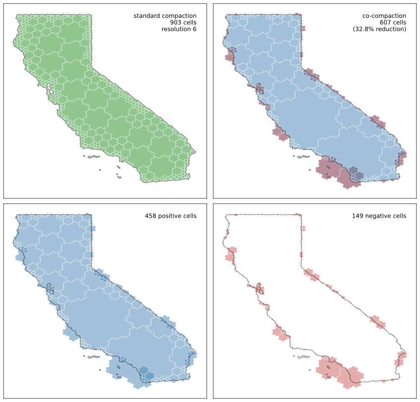
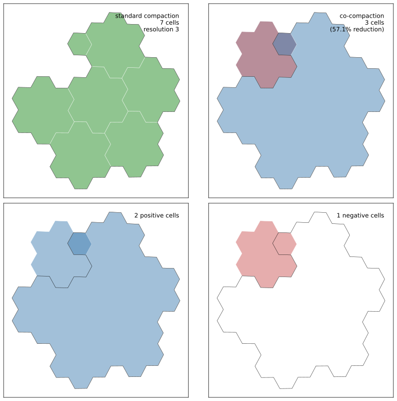

# h3coco

"Dual" compaction (or co-compaction) for H3 cells.

## Idea

If your uncompaction operation can both add and remove cells, then you can
store a "co-compacted" set of H3 cells more tersely than if
you can just add cells (standard H3 uncompaction).

This repo provides proof-of-concept implementations for `h3coco.compact`
and `h3coco.uncompact`.

A co-compacted set is a collection of cells
marked for addition or subtraction, which we represent here with a `dict[str, int]`
like:

```python
{'8049fffffffffff': 1, '8048fffffffffff': -1, ...}
```

(Alternatively, you might just store a "positive" array of cells and a "negative" array of cells.)

We're seeing around 34% to 46% reduction in number of cells needed, compared
to standard H3 compaction.

Here's California:




## How?

Standard `h3.compact_cells` merges cells when all 7 children are present (for hexes).
That means, if we have 6 out of 7 children present, the compacted representation
takes up 6 cells.
If, instead, we store "+1 for the parent" and "-1 for the missing child",
then we only need 2 cells to represent the original set of 6. (Just note
that we do need to keep track of which are positive and which are negative.)

You can extend this idea up the entire H3 cell hierarchy. Here's an example
where we have one cell which appears in the uncompacted final result
after being added twice and removed once:




## Installation

```bash
pip install git+https://github.com/ajfriend/h3coco.git
```

Or add to `requirements.txt`:

```
git+https://github.com/ajfriend/h3coco.git
```

Or add to `pyproject.toml`:

```toml
dependencies = [
    "h3coco @ git+https://github.com/ajfriend/h3coco.git",
]
```

## Usage

```python
import h3coco as coco

# Get cells for a region
cells = coco.cells_for_state('california', res=6)

# Compact to signed representation
compacted = coco.compact(cells)
# Returns: {'8049fffffffffff': 1, '8048fffffffffff': -1, ...}

# Uncompact back to original cells
original = coco.uncompact(compacted, res=6)
assert original == set(cells)
```

To generate a comparison plot like the one above:

```python
cells = coco.cells_for_state('california', res=6)
coco.plot_compaction_comparison(cells, savefig='california.svg')
```

## Data format

- Input to `compact`: iterable of H3 cell strings at the same resolution
- Output from `compact`: `dict[str, int]` where values are +1 (include) or -1 (exclude)
- Input to `uncompact`: the dict from `compact`, plus target resolution
- Output from `uncompact`: `set[str]` of H3 cells at target resolution

## Comparison with h3.compact

For each state in the US, we use `h3.geo_to_cells` to get a set of H3 cells (taking finer
resolutions for smaller states), then compare the size of the compacted
sets between `h3.compact_cells` and `h3coco.compact`.

| State                |   Res |   # Cells |   h3.compact |   coco.compact |   Reduction |
|----------------------|-------|-----------|--------------|----------------|-------------|
| Georgia              |     7 |    31,596 |        1,344 |            730 |      -45.7% |
| New York             |     7 |    23,527 |        1,633 |            901 |      -44.8% |
| South Carolina       |     7 |    17,620 |        1,000 |            554 |      -44.6% |
| Nebraska             |     7 |    37,691 |        1,343 |            753 |      -43.9% |
| Louisiana            |     7 |    22,147 |        1,807 |          1,023 |      -43.4% |
| Virginia             |     7 |    21,629 |        1,775 |          1,013 |      -42.9% |
| Illinois             |     7 |    28,815 |        1,353 |            773 |      -42.9% |
| West Virginia        |     7 |    12,609 |        1,161 |            665 |      -42.7% |
| Mississippi          |     7 |    23,171 |        1,343 |            771 |      -42.6% |
| Kentucky             |     7 |    21,376 |        1,384 |            796 |      -42.5% |
| New Mexico           |     7 |    53,115 |        1,539 |            887 |      -42.4% |
| Missouri             |     7 |    34,493 |        1,511 |            875 |      -42.1% |
| Pennsylvania         |     7 |    22,512 |        1,014 |            588 |      -42.0% |
| Minnesota            |     7 |    40,334 |        1,700 |            986 |      -42.0% |
| South Dakota         |     7 |    38,756 |        1,340 |            778 |      -41.9% |
| Texas                |     7 |   116,680 |        3,610 |          2,096 |      -41.9% |
| Idaho                |     7 |    42,368 |        1,862 |          1,084 |      -41.8% |
| Tennessee            |     7 |    21,997 |        1,369 |            797 |      -41.8% |
| Delaware             |     8 |     7,305 |          813 |            475 |      -41.6% |
| Indiana              |     7 |    18,580 |        1,078 |            632 |      -41.4% |
| Alabama              |     7 |    26,201 |        1,199 |            703 |      -41.4% |
| Wyoming              |     7 |    47,720 |        1,412 |            828 |      -41.4% |
| Florida              |     7 |    31,358 |        2,198 |          1,292 |      -41.2% |
| North Dakota         |     7 |    34,547 |        1,199 |            705 |      -41.2% |
| Arizona              |     7 |    49,850 |        1,490 |            878 |      -41.1% |
| Montana              |     7 |    76,431 |        2,043 |          1,205 |      -41.0% |
| New Jersey           |     7 |     3,917 |          527 |            311 |      -41.0% |
| Washington           |     7 |    37,717 |        2,113 |          1,251 |      -40.8% |
| Vermont              |     7 |     4,547 |          515 |            305 |      -40.8% |
| District of Columbia |    10 |    12,107 |          791 |            469 |      -40.7% |
| Wisconsin            |     7 |    26,918 |        1,394 |            828 |      -40.6% |
| Colorado             |     7 |    47,881 |        1,387 |            825 |      -40.5% |
| Nevada               |     7 |    52,210 |        1,582 |            946 |      -40.2% |
| Alaska               |     6 |    44,878 |        5,242 |          3,144 |      -40.0% |
| New Hampshire        |     7 |     4,408 |          526 |            316 |      -39.9% |
| Rhode Island         |     8 |     3,815 |          749 |            453 |      -39.5% |
| California           |     7 |    74,445 |        2,601 |          1,575 |      -39.4% |
| North Carolina       |     7 |    27,806 |        1,946 |          1,182 |      -39.3% |
| Oklahoma             |     7 |    32,054 |        1,610 |            978 |      -39.3% |
| Oregon               |     7 |    50,532 |        1,518 |            926 |      -39.0% |
| Ohio                 |     7 |    20,894 |        1,022 |            626 |      -38.7% |
| Maine                |     7 |    15,311 |        1,199 |            735 |      -38.7% |
| Iowa                 |     7 |    28,395 |        1,167 |            717 |      -38.6% |
| Michigan             |     7 |    27,703 |        2,419 |          1,489 |      -38.4% |
| Arkansas             |     7 |    25,391 |        1,157 |            713 |      -38.4% |
| Maryland             |     7 |     5,391 |        1,167 |            725 |      -37.9% |
| Hawaii               |     7 |     2,785 |          709 |            441 |      -37.8% |
| Kansas               |     7 |    38,756 |        1,214 |            768 |      -36.7% |
| Massachusetts        |     7 |     4,010 |          704 |            446 |      -36.6% |
| Utah                 |     7 |    39,272 |        1,280 |            812 |      -36.6% |
| Connecticut          |     7 |     2,454 |          318 |            210 |      -34.0% |
| Puerto Rico          |     7 |     2,431 |          367 |            243 |      -33.8% |
